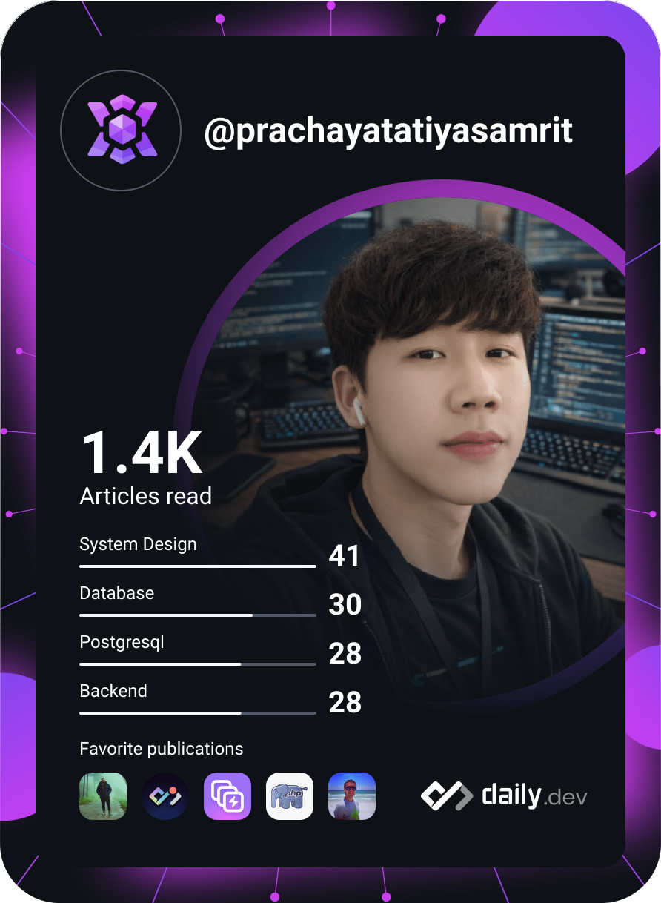

## 👋 Hi, I'm Prachaya Tatiyasamrit

**Full Stack Developer** from Chiang Mai, 🇹🇭 Thailand. I've spent 6 years shipping real-time platforms, restaurant POS systems and APIs that serve thousands of users. My strengths are **Go** and **Node.js** backends, **Vue** frontends and **Flutter**, running on **GCP** and **AWS**.

> 💬 *"Code is like humor. When you have to explain it, it's bad."* — Cory House

### 🛠 Tech Stack

- **Languages:** Go, TypeScript, JavaScript, Dart, C#
- **Backend:** Go, Node.js, ASP.NET · REST, gRPC, GraphQL, WebSockets, OAuth/JWT
- **Frontend & Mobile:** Vue, React, Flutter
- **Data:** PostgreSQL, MongoDB, Redis, Firebase
- **Cloud & DevOps:** GCP, AWS, Docker, Terraform, CI/CD, Linux
- **Testing & Design:** Jest, Cypress, Selenium, Figma, Adobe XD
- **Practices:** Agile (Scrum), code review, automated testing

### 💼 Experience

- **Full Stack Developer** · Infinity Code · *Sep 2022 – Present*: client web apps & APIs, Flutter tablet apps (incl. a restaurant POS), DB design, CI/CD, code review
- **Backend Developer** · Paiduaykanmai · *Apr – Aug 2022*: real-time research data pipeline; **40% faster** data access through DB & server tuning
- **Junior Backend Developer** · Infinity Code · *Dec 2020 – Mar 2022*: backend APIs; **30% less** server downtime through load optimization

### ✍️ Writing

Go Hexagonal Architecture · Clean Architecture for Flutter POS · Docker Compose → Cloud Run · Multi-agent dev workflows with Claude Code + Zen MCP

  
    
  
   
  💬 Let's build something amazing together!

